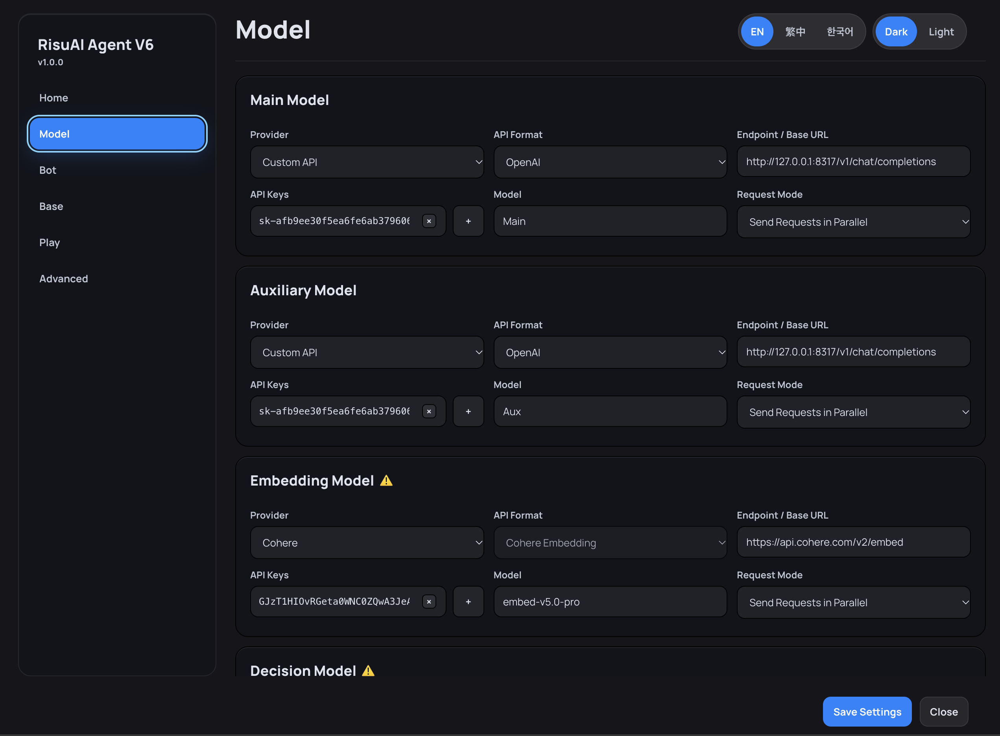

# 👤 RisuAI Agent V6

**채팅은 평소처럼, 컨텍스트와 기억 관리는 V6에 맡기세요.**

RisuAI Agent V6는 [RisuAI](https://github.com/kwaroran/Risuai)에서 캐릭터 설정과 채팅 기록을 정리하고 플레이 중 생긴 정보를 체계적으로 관리하는 플러그인입니다. 캐릭터 카드, 채팅, 모듈에서 필요한 내용을 골라 다음 요청에 반영하고 매 턴 중요한 변화를 기록합니다. 필요에 따라 **디렉터 연출 지침**과 **페르소나 추출** 기능도 사용할 수 있어, RP에 사용하는 메인 모델이 현재 장면에 더 집중할 수 있습니다.

[English](README.md) | [繁體中文](README.zh-TW.md) | **한국어**

> [!IMPORTANT]
> V6는 추가로 모델을 호출합니다. 더 정확한 정보 검색을 원한다면 **의사결정 모델**, **임베딩 모델** 중 하나 이상을 설정할 수 있습니다. 이 모델들은 RisuAI 본체의 채팅 모델과 별도로 설정하며, 요청량과 대기 시간, 비용은 활성화한 기능과 제공업체에 따라 달라집니다.

## 🔄 V6는 어떻게 작동하나요?

V6는 기존 채팅 흐름을 바꾸지 않고, 메시지를 보내기 전후에 필요한 정보를 처리합니다.

초기 설정을 마치면 V6 화면을 매번 열 필요 없이 평소처럼 채팅하면 됩니다.

## ✨ 주요 기능

### 📚 정보 정리와 관련 자료 검색

- **자료를 구분해서 관리:** 캐릭터 카드, 채팅, 모듈 정보를 나누어 정리한 뒤 현재 상황에 필요한 내용을 조합합니다. 분류된 모듈 항목은 다른 캐릭터 카드에서도 재사용할 수 있습니다.
- **검색 방식 선택:** 의사결정 모델과 임베딩 모델을 따로 사용하거나 함께 사용해 관련 항목을 찾습니다. 둘 다 사용하지 않으면 키워드 매칭 방식으로 전환됩니다.
- **불필요한 정보 최소화:** 쌓인 항목을 매번 모두 넣지 않고 필요한 정보만 골라 프롬프트를 구성합니다. 절감되는 토큰 수는 설정에 따라 달라집니다.

### 🧠 플레이 기록과 기억 관리

- **턴 노트:** 매 턴 응답이 끝날 때 중요한 전개를 기록합니다.
- **네 가지 기록 항목:** **물건, 사건, 관계, 지식**에 관한 변화를 정리합니다.
- **기록 정리:** 중복되거나 오래된 정보가 계속 쌓이지 않도록 플레이 기록을 정돈합니다.
- **장기 요약:** 선택한 작동 모드에 따라 사용할 수 있습니다.
- **기록 다시 만들기와 채팅 이어가기:** 기존 채팅을 바탕으로 플레이 기록을 다시 만들고, 최근 대화를 유지한 새 채팅에서 이어갈 수 있습니다.

### 🎬 선택 기능 및 봇별 설정

- **디렉터 연출 지침:** 중요한 전개를 짚어 다음 응답의 방향을 제안합니다. 모델이나 캐릭터 카드가 이미 서사를 잘 이끈다면 꺼두어도 됩니다.
- **페르소나 추출:** 캐릭터 설정에서 성격 정보를 추출해 보완합니다. 캐릭터 설정이 충분히 자세하다면 끄거나, **페르소나 수동 연결**로 필요한 대상만 지정할 수 있습니다.
- **봇별 설정:** 전역 기본값을 유지하면서 캐릭터 카드마다 필요한 설정을 따로 적용할 수 있습니다.

## 🚀 시작하기

1. RisuAI에서 **RisuAI Agent V6** 플러그인을 가져와 활성화합니다. 필요하다면 RisuAI를 다시 시작하고 플러그인 권한을 허용합니다.
2. V6의 **모델(Model)** 페이지에서 **메인 모델**과 **보조 모델**을 설정합니다. 고급 검색 기능을 사용하려면 **의사결정 모델** 또는 **임베딩 모델**도 설정합니다.
3. 아래의 필수 설정에 따라 **기존 프리셋의 프롬프트 배치를 수정합니다.**
4. V6의 **봇(Bot)** 페이지에서 전역 설정과 캐릭터 카드별 설정을 조정합니다.
5. RisuAI로 돌아가 평소처럼 채팅하면 됩니다. V6가 요청 전에 필요한 정보를 준비하고 응답 후에는 플레이 기록을 갱신합니다.

### 🧋 프리셋 프롬프트 설정 (필수)

> [!IMPORTANT]
> V6를 사용하기 전에 **기존 프리셋의 프롬프트 배치를 반드시 수정해야 합니다.** 이 GitHub 저장소에는 바로 사용할 수 있는 완성형 프리셋이 포함되어 있지 않습니다.

**방법 1 — 직접 수정하기**

1. **프롬프트 목록에서 제거:** **캐릭터 설명**, **로어북**, **장기 기억(Supa/HypaMemory)**, **글로벌 노트**.
2. **과거 채팅(Past Chats)** 범위를 `-10~0`으로 설정합니다.

삭제하는 것은 **프리셋에 배치된 프롬프트 항목**뿐입니다. 캐릭터 카드, 로어북 항목 등 원본 데이터는 삭제하지 마세요.

**방법 2 — 🛠️ 프리셋 조정 도구 사용하기**

**프리셋 조정 도구**는 가지고 있는 `.risup` 파일을 V6에 맞는 프롬프트 구성으로 변환하는 **로컬 Python 도구**입니다. 완성된 프리셋을 제공하는 것은 아니므로, 변환할 파일은 직접 준비해야 합니다.

**도구 언어 선택:** [한국어](risup_preset_adjuster_v1_ko.zip) · [English](risup_preset_adjuster_v1_en.zip) · [繁體中文](risup_preset_adjuster_v1_zh-TW.zip)

**사용 방법:**

1. 원하는 언어의 ZIP 파일을 내려받아 압축을 풉니다. **Python 3**가 설치되어 있어야 합니다.
2. 변환할 `.risup` 파일을 압축 해제한 폴더의 `input/`에 넣습니다. 여러 파일을 한 번에 넣어도 됩니다.
3. **Windows:** `run.bat`를 더블클릭합니다. **macOS / Linux:** 압축을 푼 폴더에서 터미널을 열고 `python3 risup_adjust.py`를 실행합니다.
4. 완료되면 `output/`에서 변환된 `.risup` 파일을 확인하고 RisuAI로 가져옵니다.
5. 변환된 프리셋을 선택한 뒤, **필수 항목이 빠졌는지, 과거 채팅 범위가 `-10~0`인지 확인합니다.**

> [!NOTE]
> 원본 프리셋은 백업해 두는 것을 권장합니다. V6의 모델 설정은 RisuAI 본체의 채팅 모델 설정과 별개이며, 같은 제공업체를 사용하더라도 자동으로 동기화되지 않습니다.

## 🤖 V6 모델 구성

| 모델 | 주요 역할 |
| --- | --- |
| **메인 모델 (Main Model)** | 복잡한 분석, 플레이 기록 다시 만들기, 구조화된 기억 처리 |
| **보조 모델 (Auxiliary Model)** | 비교적 가벼운 보조 작업 |
| **의사결정 모델 (Decision Model)** | 자료 분류, 관련성 판단, 항목 선별 |
| **임베딩 모델 (Embedding Model)** | 의미 기반 유사도(벡터) 검색 |

프로젝트 테스트에서는 임베딩 모델 없이 **의사결정 모델만 사용**한 구성이 관련 항목을 정확하게 고르는 데 좋은 결과를 보였습니다. 다만 캐릭터 카드와 언어, 모델에 따라 결과는 달라질 수 있습니다. 두 모델을 모두 끄면 키워드 매칭을 사용합니다.

## 🔁 진행 중인 채팅에서 V6 사용하기

**기존 채팅 기록이 모두 남아 있다면:**

1. V6의 **플레이(Play)** 페이지를 엽니다.
2. **플레이 기록 다시 만들기(Rebuild Play Records)**를 선택합니다.
3. 작업이 끝날 때까지 기다립니다. 채팅 길이에 따라 시간이 오래 걸리거나 메인 모델 호출량이 늘어날 수 있습니다.

**예전 메시지가 잘려 나갔다면:**

1. 복구할 수 있는 이전 요약을 모읍니다.
2. 해당 요약을 **로어북** 항목으로 만든 뒤, V6의 **베이스(Base) → 과거 기록(Past History)**으로 분류합니다.
3. 남아 있는 채팅 기록을 바탕으로 **플레이 기록 다시 만들기**를 실행합니다.

작업이 중단되면 **플레이 기록 다시 만들기**를 다시 실행해 이어서 처리할 수 있습니다.

> **호환성 참고:** 캐릭터 카드에 별도의 2차 모델 출력 단계가 있다면 **플레이 기록 생성 모델(Play Record Generator)**을 **모델 응답에 첨부(Append to Model Reply)**로 설정하지 않는 것이 좋습니다. 플레이 기록 일부가 누락될 수 있습니다.

## ❓ 자주 묻는 질문

**별도의 데이터베이스를 설치해야 하나요?**  
아니요. RisuAI의 플러그인 저장 기능을 사용하므로 외부 데이터베이스가 필요하지 않습니다.

**채팅하는 방식도 바뀌나요?**  
아니요. 설정을 마치면 이전과 똑같이 RisuAI를 사용하시면 됩니다.

**디렉터 연출 지침과 페르소나 추출을 꼭 켜야 하나요?**  
그럴 필요는 없습니다. 캐릭터 설정이 충분하거나 모델 자체의 서사 능력이 좋다면 이러한 기능을 끄고 사용해도 됩니다.

**긴 채팅을 진행하다가 중간에 적용할 수 있나요?**  
네. 남아 있는 채팅에서 플레이 기록을 다시 만들 수 있습니다. 이전 메시지가 잘렸다면 복구 가능한 요약을 먼저 과거 기록으로 분류해 주세요.

**추가 비용이나 대기 시간이 발생하는 이유는 무엇인가요?**  
검색, 기억 갱신, 선택한 보조 기능에 따라 추가 모델 호출이 발생하기 때문입니다. 호출 횟수는 설정에 따라 달라집니다.

## 📜 라이선스

이 프로젝트는 [GNU General Public License v3.0](LICENSE)에 따라 배포됩니다.
