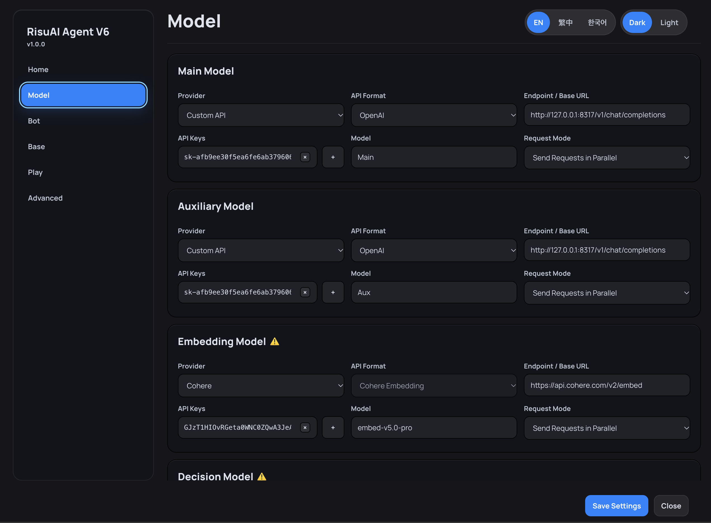

# 👤 RisuAI Agent V6

**Stay in the story. Let V6 handle context and memory.**

RisuAI Agent V6 is a context and memory management plugin for [RisuAI](https://github.com/kwaroran/Risuai). It organizes character-card, chat, and module data; retrieves relevant background information; and records important developments as you play. Optional **Director Guidance** and **Persona Extraction** can further support the roleplay model, letting it focus on the next response.

**English** | [繁體中文](README.zh-TW.md) | [한국어](README.ko.md)

> [!IMPORTANT]
> V6 makes additional model requests. For more relevant retrieval, configure a **Decision Model**, an **Embedding Model**, or both. V6's models are configured independently of RisuAI's chat models. Request volume, latency, and cost depend on the features and providers you use.

## 🔄 How V6 Works

V6 works alongside your existing RisuAI chat flow:

Once set up, V6 works alongside your chats. You do not need to reopen its interface for every turn.

## ✨ Core Features

### 📚 Context Organization and Retrieval

- **Base data organization:** Keeps character, chat, and module data separate, then assembles relevant information for the current exchange. Classified module entries can also be reused across compatible character cards.
- **Flexible retrieval:** Uses a Decision Model, an Embedding Model, or both to select relevant entries. If both are disabled, V6 falls back to keyword matching.
- **Focused prompts:** Filters out unrelated entries rather than inserting everything into each request. Actual token savings vary with your configuration.

### 🧠 Play Records and Memory

- **Turn Notes:** Records noteworthy developments after each completed model response.
- **Four record categories:** Tracks changes involving **Objects, Events, Relationships, and Knowledge**.
- **Record consolidation:** Helps reduce redundant or outdated entries as the story progresses.
- **Long-term summaries:** Available depending on the selected operating mode.
- **Rebuild and continuation:** Rebuilds play records from existing chat history and can create continuation chats while retaining recent context.

### 🎬 Optional Features and Per-Bot Settings

- **Director Guidance:** Highlights important developments and suggests a direction for the next reply. You can disable it if the model or character card already manages the narrative well.
- **Persona Extraction:** Derives additional personality information from character data. Disable it for sufficiently detailed cards, or use **Attach Persona Manually** for selected characters.
- **Per-bot settings:** Use global defaults with optional adjustments for individual character cards.

## 🚀 Getting Started

1. Import and enable **RisuAI Agent V6** in RisuAI. Restart the application if prompted and grant the necessary plugin permissions.
2. Open V6's **Model** page and configure the **Main Model** and **Auxiliary Model**. Add a **Decision Model** and/or **Embedding Model** if you plan to use those retrieval features.
3. **Adjust the prompt layout in your existing preset** as described below.
4. Open V6's **Bot** page to configure global defaults or settings for individual cards.
5. Return to RisuAI and chat normally. V6 prepares context before each request and updates play records after the response.

### 🧋 Required Preset Prompt Setup

> [!IMPORTANT]
> Before using V6, **adjust the prompt layout in your existing preset**. This repository does not include a ready-made preset.

**Option 1 — Edit your preset manually**

1. **Remove these prompt entries:** **Character Description**, **Lorebook**, **Supa/HypaMemory**, and **Global Note**.
2. **Set the Past Chats range to `-10~0`.**

These changes apply to the **preset's prompt layout only**. Do not delete character cards, Lorebook entries, or other source data.

**Option 2 — 🛠️ Use the Preset Adjuster**

The **Preset Adjuster** is a local Python tool for adapting **your own `.risup` files** to V6's prompt setup. It is not a preset pack; you supply the preset you want to convert.

**Choose a tool language:** [English](risup_preset_adjuster_v1_en.zip) · [繁體中文](risup_preset_adjuster_v1_zh-TW.zip) · [한국어](risup_preset_adjuster_v1_ko.zip)

**How to use it:**

1. Download the language version you prefer, extract the ZIP archive, and make sure **Python 3** is installed.
2. Place one or more of your `.risup` preset files in the extracted tool's `input/` folder.
3. **Windows:** Double-click `run.bat`. **macOS / Linux:** Open a terminal in the extracted folder and run `python3 risup_adjust.py`.
4. After the script finishes, find the converted `.risup` files in `output/` and import the one you want into RisuAI.
5. Select the converted preset and **verify the required prompt entries are absent and Past Chats is set to `-10~0`**.

> [!NOTE]
> Keep a backup of your original preset. V6's model configuration is separate from RisuAI's chat-model settings, even when both use the same provider.

## 🤖 Choosing V6 Models

| Model | Role |
| --- | --- |
| **Main Model** | Handles more demanding analysis, play-record rebuilding, and structured memory tasks. |
| **Auxiliary Model** | Handles lighter supporting tasks. |
| **Decision Model** | Classifies and selects entries by relevance. |
| **Embedding Model** | Enables semantic similarity (vector) retrieval. |

In project testing, a **Decision Model without an Embedding Model** performed particularly well at selecting relevant entries. Results vary by model, language, and character card. Keyword matching remains available when both retrieval models are disabled.

## 🔁 Using V6 with an Ongoing Chat

**If the complete chat history is still available:**

1. Open **Play** in V6.
2. Select **Rebuild Play Records**.
3. Let the rebuild finish. Longer histories can take more time and require additional Main Model requests.

**If earlier chat messages have been trimmed:**

1. Collect any older summaries you can still recover.
2. Save the summaries as **Lorebook** entries, then classify them under **Base -> Past History** in V6.
3. Run **Rebuild Play Records** using the remaining chat history.

If the process stops partway through, you can run **Rebuild Play Records** again to resume.

> **Compatibility note:** If a character card has an additional model-output stage, avoid setting the **Play Record Generator** to **Append to Model Reply**. Otherwise, some play records may be missed.

## ❓ FAQ

**Do I need a separate database?**  
No. V6 uses RisuAI's plugin storage, so no external database is required.

**Do I have to change how I send messages?**  
No. Once configured, you can use RisuAI as usual.

**Should I always enable director guidance and persona extraction?**  
No. A well-written character card or a capable narrative model may work better without additional guidance. Enable only what you need.

**Can I use V6 halfway through a long chat?**  
Yes. Rebuild the play records from the available history. For trimmed conversations, add any recoverable earlier summaries as Past History first.

**Why are there extra requests or delays?**  
V6 may make extra model requests for retrieval, memory updates, and optional guidance. The number of requests depends on which features you enable.

## 📜 License

This project is licensed under the [GNU General Public License v3.0](LICENSE).
