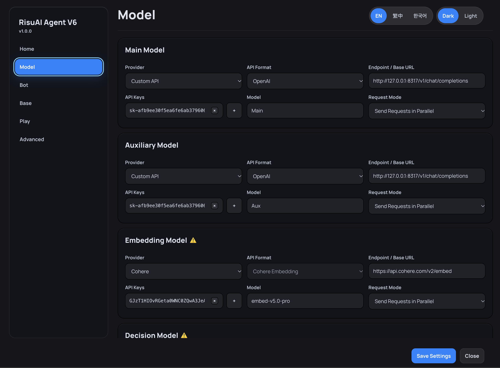

# 👤 RisuAI Agent V6

**你專心互動，V6 負責整理設定與記憶。**

RisuAI Agent V6 是為 [RisuAI](https://github.com/kwaroran/Risuai) 設計的上下文與記憶管理外掛。它會整理角色卡、對話與模組資料，選取當前回合需要的背景資訊，並記錄遊玩過程中的重要變化；也能視需求啟用**導演指導**或**人格萃取**，讓主要 RP 模型更專注於當下的回應。

[English](README.md) | **繁體中文** | [한국어](README.ko.md)

> [!IMPORTANT]
> V6 會額外呼叫模型。若想提升資訊檢索的相關性，可設定**決策模型**、**嵌入模型**，或同時啟用兩者。V6 的模型設定與 RisuAI 本體的聊天模型設定分開管理；實際用量、延遲與費用取決於啟用功能和服務供應商。

## 🔄 V6 如何運作

V6 會配合你原本的 RisuAI 對話流程運作：

完成初次設定後，照平常方式聊天即可，不需要每回合重新開啟 V6 介面。

## ✨ 核心功能

### 📚 資料整理與相關資訊檢索

- **資料分類與整合：** 分別管理角色卡、對話與模組資料，再依目前的對話組合所需內容。已分類的模組條目，也能視情況用於其他角色卡。
- **彈性檢索：** 可以單獨或同時使用**決策模型**與**嵌入模型**來篩選相關條目；兩者皆停用時，改用關鍵字比對。
- **精簡提示詞：** 不會在每次請求中塞入所有累積條目，而是優先選取相關資訊。實際節省的 Token 數量會因設定而異。

### 🧠 遊玩記錄與記憶管理

- **回合筆記：** 每次完成回應後，記錄重要進展。
- **四大分類：** 整理**物件、事件、關係與知識**的變化。
- **資料收斂：** 隨著劇情推進，減少重複或過時的記錄。
- **長期彙總：** 依所選運作模式啟用。
- **重建與接續：** 可從既有對話重建遊玩記錄，也能建立保留近期上下文的接續聊天。

### 🎬 選用功能與個別設定

- **導演指導：** 篩選重要發展並提供下一次回應的方向；若模型或角色卡本身已能妥善安排敘事節奏，可以關閉。
- **人格萃取：** 從角色資料補充性格資訊。若角色卡設定已相當完整，可將此功能停用；也能透過**手動附加人格**，只連結指定角色。
- **個別 Bot 設定：** 除了全域預設值，也能針對不同角色卡調整。

## 🚀 開始使用

1. 在 RisuAI 匯入並啟用 **RisuAI Agent V6**。若系統提示，請重新啟動 RisuAI，並授予外掛所需權限。
2. 開啟 V6 的 **「模型」（Model）** 頁面，設定**主模型**與**輔助模型**。若要使用進階檢索，再設定**決策模型**或**嵌入模型**。
3. 依照下方說明，**調整現有預設集（Preset）的提示詞配置**。
4. 進入 V6 的 **Bot** 頁面，調整全域設定或個別角色卡設定。
5. 回到 RisuAI，照平常方式送出訊息。V6 會在請求前準備相關內容，並於回應完成後更新遊玩記錄。

### 🧋 Preset 提示詞設定（必要）

> [!IMPORTANT]
> 使用 V6 前，**必須先調整你現有的預設集（Preset）提示詞配置**。本 GitHub 儲存庫不提供可直接使用的現成 Preset。

**方式一：手動調整**

1. **從提示詞排列中移除：** **角色設定**、**Lorebook**、**Supa/HypaMemory** 與 **全域備註**。
2. **將「過往對話」（Past Chats）的範圍設為 `-10~0`。**

這裡移除的是**預設集中的提示詞欄位**，不是刪除角色卡、Lorebook 條目或其他原始資料。

**方式二：🛠️ 使用 Preset 調整工具**

**Preset 調整工具**是本機 Python 轉換工具，可將**你自己的 `.risup` 預設集檔案**調整成適合 V6 的提示詞配置。工具本身不包含現成 Preset，需自行提供原始檔案。

**選擇工具語言：** [繁體中文](risup_preset_adjuster_v1_zh-TW.zip) · [English](risup_preset_adjuster_v1_en.zip) · [한국어](risup_preset_adjuster_v1_ko.zip)

**使用步驟：**

1. 下載對應語言的 ZIP 並解壓縮，確認電腦已安裝 **Python 3**。
2. 將要修改的 `.risup` 檔案放進工具的 `input/` 資料夾；可以一次放入多個檔案。
3. **Windows：** 雙擊 `run.bat`。**macOS／Linux：** 在解壓縮後的資料夾開啟終端機，執行 `python3 risup_adjust.py`。
4. 執行完成後，到 `output/` 資料夾取得轉換後的 `.risup` 檔，再匯入 RisuAI。
5. 選用轉換後的預設集，**再次確認指定欄位已移除，且「過往對話」範圍為 `-10~0`**。

> [!NOTE]
> 建議保留原始 Preset 備份。V6 的模型設定與 RisuAI 本體的聊天模型設定分開管理，即使使用相同服務供應商，也不會自動同步。

## 🤖 V6 模型選擇

| 模型 | 主要用途 |
| --- | --- |
| **主模型（Main Model）** | 負責較深入的分析、重建遊玩記錄及結構化記憶整理。 |
| **輔助模型（Auxiliary Model）** | 處理較輕量的輔助工作。 |
| **決策模型（Decision Model）** | 條目分類、相關性判斷與資訊篩選。 |
| **嵌入模型（Embedding Model）** | 語意／向量相似度檢索。 |

根據專案測試，單獨使用**決策模型**（不啟用嵌入模型）在條目篩選上表現良好；實際效果仍會因模型、語言與角色卡而異。兩種檢索模型都停用時，V6 仍可使用關鍵字比對。

## 🔁 在進行中的對話啟用 V6

**若完整對話記錄仍在：**

1. 開啟 V6 的 **「遊玩」（Play）** 頁面。
2. 點選 **「重建遊玩記錄」（Rebuild Play Records）**。
3. 等待重建完成。這項操作可能耗時較長，也會增加 V6 主模型的呼叫量。

**若早期對話已被裁切：**

1. 整理還能取得的舊摘要。
2. 將舊摘要建立為 **Lorebook** 條目，再到 V6 的 **「基底」（Base）→「過往歷史」（Past History）** 進行分類。
3. 利用剩餘的對話記錄執行 **「重建遊玩記錄」**。

若中途停止，可以再次執行 **「重建遊玩記錄」**，接續處理。

> **相容性提醒：** 若角色卡有額外的二次模型輸出機制，請避免將**遊玩記錄產出者（Play Record Generator）**設為**「附加於模型回應」（Append to Model Reply）**，以免漏記部分資料。

## ❓ 常見問題

**需要額外安裝資料庫嗎？**  
不需要。V6 使用 RisuAI 的外掛儲存機制，無須額外架設資料庫。

**使用 V6 後，需要改變聊天方式嗎？**  
不需要。完成設定後，照平常方式使用 RisuAI 即可。

**一定要啟用導演指導和人格萃取嗎？**  
不用。設定完善的角色卡或敘事能力較強的模型，不一定需要這些附加功能。

**長篇對話進行到一半才安裝，可以接續嗎？**  
可以。使用重建遊玩記錄功能；若舊訊息已裁切，先將能找回的摘要加入過往歷史。

**為什麼會出現額外費用或等待時間？**  
V6 會依啟用的檢索、記憶與指導功能，發出額外的模型請求；實際次數依設定而異。

## 📜 授權

本專案採用 [GNU General Public License v3.0](LICENSE)。
